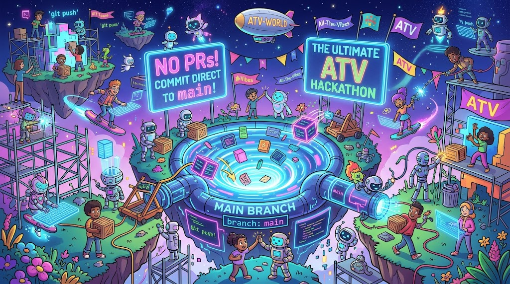

# 🌍 ATV World

**One world. All the vibes. Absolutely no pull requests.**

Welcome to the ultimate All the Vibes hackathon: a virtual world built by everyone, owned by everyone, and occasionally set on fire by everyone. Every ATV team member can commit directly to `main`. The world is our canvas. Git history is our incident documentary.

## Meet the agents of questionable judgment

- **Steph:** Turning “what if we…” into a shared universe and everyone else's weekend plans.
- **Darth Vader:** Finds your lack of commits disturbing.
- **Nemo:** Just keep shipping. Just keep shipping.
- **Ralph Wiggum (The Simpsons):** “I'm a developer!” Somehow, his code works.
- **Pac-Man:** Eats bugs. Also dependencies. Also the floor.
- **Rocky (Project Hail Mary):** Five limbs. Zero excuses. Amaze, amaze, amaze!
- **A Girl Scout:** Ships features. Sells cookies. The only agent with a sustainable business model.
- **A Phoenix:** Calls every production outage a personal rebrand.

## How to make this everyone's problem

1. Pull the latest `main`.
2. Add something wonderful: a place, a character, a game, or a deeply unnecessary volcano.
3. Commit and push straight to `main`. No PRs. No approval queue. You live here now.
4. Respect each other's creations. If you break the world, help fix it. Bring snacks.

**Build boldly. Pull often. Leave the world weirder than you found it.**

## Prerequisites

| Tool | Version | Notes |
| --- | --- | --- |
| [Node.js](https://nodejs.org/) | 24 LTS (22.12+ works) | `.nvmrc` pins 24 |
| npm | 10+ | Ships with Node |
| [Git](https://git-scm.com/) | Any recent version | You'll be pushing to `main` a lot |
| A browser | WebGL 2 | Chrome, Edge, Firefox, or Safari 15+ |

Optional: [GitHub CLI](https://cli.github.com/) to watch your push go live (`gh run watch`).

## What's inside

**Stack:** Phaser 4.2, React 19.3, TypeScript 7.0, and Vite 8.3.

- `src/game/kit/` draws all the pixel art in code: characters, buildings, trees, props, and a tiny font. Every color slot takes any color, and every catalog is open, so add your own.
- `src/game/world/layout.ts` is the lot grid the town grows on.
- `src/game/scenes/Preview.ts` is the world on the live screen. Find all six glowing vibes, chain quick pickups for a combo, and clear a round for a temporary speed rush. Press Space for a short-range Vibe Pulse that grabs nearby shards and makes the locals hop.
- `src/game/llama/Ollama.ts` runs a fluffy pixel-art llama around the plaza. It says "Hi, I'm Ollama!" followed by "I run local. Mostly in circles." on a repeating speech-bubble loop.
- `src/game/rubberDuck/` adds a large, glossy yellow Rubber Duck waddling around the plaza on little orange legs and webbed feet. Its first words are "Hi I'm Rubber Duck", followed by very polite offers to review code, ideas, edge cases, and tests. Click the duck to advance its dialogue, or let it chat automatically. These are in-world conversation prompts, not an external code-review service. Run `node tests/rubber-duck-browser.mjs` to check its art, movement, and dialogue.
- `src/game/talkingMoles/` runs three staggered lawn burrows, separate from the Whack-a-Mole game. Pixel-art moles pop out, share eight rotating jokes about AI agents, vibe coding, and token bills, then disappear underground. Each joke stays up for 5.5 seconds before its mole burrows away; no clicks needed. `node tests/moles-browser.mjs` checks the full cycle in a real browser.
- `src/game/pool/` is a swimming pool with a high dive next to ATV HQ. Swimmers queue up, climb the ladder, bounce on the board, and dive, flip, cannonball, or belly flop in, saying something silly when they splash down.
- **📺 Digital AI Billboard:** A giant electronic LED advertising board stands by the road into Town. It auto-rotates through eight humorous parody ads selling absurd AI products (Vibe Insurance, Prompt-O-Matic 9000, Organic Tokens, GPU Space Heater, AGI Soon™, AI Apologizer Pro, Quantum Guesser, and Autonomous Loop Agent) with animated marquee chase lights and CRT scanline transitions. Click the billboard to skip to the next ad and pop up a witty quip.
- Abdallah walks around town with a pixel-art nameplate.
- **Chaos / Incident Button:** Click the big red button beside the production station west of the plaza (or walk nearby and press **C**). It randomly starts a building fire, power outage, alien invasion, or network failure. Watch, Patch, and Rollback detect the incident, run to the station, visibly repair it, and return to standby. The board and progress bar show recovery; one incident runs at a time. These are harmless in-world drills, not real service outages. Run `node tests/incidents-browser.mjs` to check every incident and the input guards.
- **🛠️ Self-Healing Repair Crew:** Watch, Patch, and Rollback automatically detect and fix a simulated fault after 30 seconds on standby, using animated wrenches and repair sparks. Click the **AUTO ON/OFF** sign beneath the incident board to pause or enable automatic drills; manual chaos-button use still works. Disabling automation lets any current repair finish. The standby timer only advances while the world is active, you're outside HQ, and you're not typing; each return to standby starts a fresh countdown. This crew repairs the in-world production station, not real code, workflows, or services.
- **💡 Idea Machine:** Walk up to the lightbulb machine just left of the starting spot, then press **E** or click it for a random build challenge. Try building an arcade game, creating an AI character, or adding something that changes the whole world. Press again for a different idea.
- A flying saucer circles above town with a little alien pilot, chasing lights, and a hovering shadow.
- Steph strolls across the plaza automatically, with a `STEPH` name tag, blonde hair, a red top, and dark pants. The existing arrow-key player is unchanged. Her transparent walk sheet is `assets/steph-walk.png`, cut from the supplied artwork preserved in `assets/steph-reference.png`. Run `npm run test:steph` to check her walk, turns, and player controls.
- `src/game/terrain/` paints the ground once at startup: sunlit and shady meadow, tufts and wildflowers, the cobbled plaza ring, lanes out to every building, a lily-pad pond with reeds, and a little park inside the road loop. Scenery skips anything that would land on a building or road, so build freely.
- `src/game/life/` keeps the town breathing: one shared breeze sways every tree canopy, petals and leaves fall, chimneys smoke, the fountain sprays, butterflies visit the flower beds, birds cross the sky, and footsteps kick up dust.
- `src/game/fx/` is the lighting: a six-minute day/night loop (golden morning, bright day, sunset, deep blue night, rose dawn) with drifting cloud shadows, sun shafts, a colour grade, lamp-lit streets, glowing windows, headlights and fireflies after dark. T skips ahead (Shift+T back), and `?time=night` (or `dawn`, `day`, `dusk`, `sunset`, or `0`..`1`) freezes the clock. Anything can add its own light with `atmosphere.addLight(x, y, radius, color)`.
- `src/game/view.ts` is the camera: F fits the whole world, +/- or the mouse wheel zooms, dragging looks around, and the view survives reloads.
- `src/game/kittens.ts` runs the south-lawn cat and kitten corral: eight slippery kittens, 24 toys (yarn, balls, mice, tunnels, scratching posts and feather teasers), and a project manager trying to carry escapees home. Two adventurous kittens roam across town hunting the dragon; the other six prefer local mischief. They bat at coins without spending them, pounce at the dragon, and dance and tell '70s jokes on the disco floor. People get distracted and exchange meows: "I have to get back to work now.. err... meow, meow." Press F to fit the whole playground; `npm run test:kittens` checks their antics in a real browser.
- `src/game/kittens.ts` runs the south-lawn cat and kitten corral: eight slippery kittens, 24 toys (yarn, balls, mice, tunnels, scratching posts and feather teasers), and a project manager trying to carry escapees home. Kittens get bored, dodge catches, bat at dropped coins without spending them, and chase and jump toward a nearby dragon. People get distracted and exchange meows: "I have to get back to work now.. err... meow, meow." Press F to fit the whole playground; `npm run test:kittens` checks their antics in a real browser.
- **🏭 Agent Factory:** Walk into the brick factory with the robot on its roof (east of the plaza, below the pool), or click it, to pick a role: Developer, SRE, Security Agent, or Tester (click a card or press 1-4). A new agent rolls out on the conveyor belt and wanders town with a name tag, muttering lines and handing work to the other roles it bumps into. Up to twelve at a time; the oldest goes home first. Press **Esc** to close the picker. Roles live in `src/factory/roles.ts`.
- `src/live.ts` is the LIVE badge in the bottom left. It shows the commit that's live and reloads the page when a newer push deploys.
- `src/music/` is the background music: an 80s arcade loop made with Gemini. The speaker button or M turns it off and on.

Every push to `main` goes live within a few minutes, and the live page reloads itself to show it. CI (typecheck and build) and CodeQL run on every push too.

## Character creator nametags

The **@** button beside **− / FIT / +**, at the bottom right, turns all GitHub
creator labels on or off for the session. It works in every scene and applies to
characters spawned later. Character names, role plates, token counts and speech stay visible.

Set `githubUsername` (without `@`, preserving casing) on the character's look:

```ts
const look = randomLook('my-character', { githubUsername: 'YourGitHubLogin' });
// After creating the sprite from that look:
addCreatorNametag(sprite, look);
```

Both helpers are exported from `src/game/kit`. Omit `githubUsername` when ownership
is unknown. It identifies the character's creator, not the author of the shared
drawing kit, a later editor, the current viewer, or a Teams participant. Never
derive it from a display name, participant ID, texture key, or login session.
The label follows movement, visibility and opacity; destroying the sprite or
stopping its scene removes the label and its listeners. Player markers and speech
bubbles have separate space; labels keep a 12px screen font at every zoom.
Crowded full-world views can overlap tags; zoom in to read individual characters.

Backfill evidence (creation diffs and GitHub's commit-author account association,
checked October 16, 2026):

| Characters | Creator | Introduction commit |
| --- | --- | --- |
| Six street walkers (`preview-0` through `preview-5`) | `Bakar404` | `9c37211d647e5fba6a20dd7e8149f0509abd52de` |
| Player, including library and Mars copies (`PLAYER_LOOK`) | `vvundela1111` | `9fd2cf3a9bd3c02e8374a6dc25b13737725deb52` |
| Abdallah (the named street walker) | `aifateen` | `3c1fb9c186c8051a961a26073761e970347316de` |
| Disco dancers | `markbriggs-ms` | `c5fedcc91e9cd741957049bda145811b8a768dc4` |
| Dragon | `markbriggs-ms` | `b13d64dd83a60f510e921dfeed1eb3d8bf8e4400` |
| Kitten playground's project manager | `DeaderestPool` | `bee168535494ad2ed5f4eef73dcfdfd2da2e8be0` |
| Kittens | `DeaderestPool` | `bee1685` |
| Steph / Daenerys | `stephschofield` | `2c3ea0c` / `2736f55` |
| Ahmed / campus walkers | `Bakar404` | `2f93583` / `0431fbe` |
| Bike gang / Locke siblings | `ShahabName` | `e205f51` / `fba5687` |
| Wednesday | `ShahabName` | `3226433` |
| Repair crew / factory role templates / saucer pilot | `aifateen` | `e59d0a2` / `861331c` / `155f1b7` |
| Pool swimmers / tug-of-war pullers | `markbriggs-ms` | `0da492f` / `1030554` |
| Ollama / giant / talking lawn moles | `markbriggs-ms` | `132c652` / `39ba278` / `ea467d3` |
| Rubber Duck / Mark B | `markbriggs-ms` | `5c15913` / `3d8e918` |
| HQ seated coders and arriving/departing avatars (`callerLook`) | **Unresolved; unlabeled** | `3ccda30b460936980682095775fdcd746f1b5f75` |

The HQ commit names Veda Vundela but has no linked GitHub author account. Confirm
the creator's account before adding `githubUsername` to `callerLook` in
`src/game/hq/art.ts`; both seated and walking sprites already support it. Existing
HQ desk plates still identify call participants, separately from creator tags.

Remaining account mappings are unverified: Veda Vundela (HQ, sorting hat,
Whack-a-Mole and lake fish) and Christian Presley (20 roamers, catchers, gremlins
and the workout class; introduction commits `bbd3095`, `5f9f885`, `d7ad2ab`, `7bfc035`). Their creation
commits have no linked GitHub author account. Roamer specs now support tags
through `look.githubUsername`; leave it absent until the account is confirmed.
Ambient scenery and effects are not character labels.

Run `node tests/nametags-browser.mjs` for focused real-Phaser regression checks at
desktop and mobile widths. It uses an OS-assigned local port and closes only its
own server. Set `NAMETAG_SCREENSHOTS` to a directory to save screenshots.

## CI/CD Traffic Light

The giant traffic light in the town square watches the latest `main` runs of Deploy, CI Health, and CodeQL. Click it to open GitHub Actions.

- **Green:** deployment and strict CI are present, and all observed checks pass.
- **Yellow:** one workflow is failing, or checks are running/cancelled.
- **Red:** deployment failed, or two or more workflows are failing.
- **Lights off:** waiting for the first CI results, or GitHub is unavailable. Unknown is never shown as healthy.

The separate CI Health workflow runs strict typecheck and build without blocking the existing resilient deployment. The light refreshes every minute through `/api/health`, which caches GitHub results for a minute per server instance. Public repository reads need no setup; optionally set the server-only `GITHUB_HEALTH_TOKEN` app setting (Actions read permission) for a higher GitHub rate limit.

Check the status rules with `node --test tests/health.test.cjs` and the game integration with `node tests/health-browser.mjs` (Edge).
